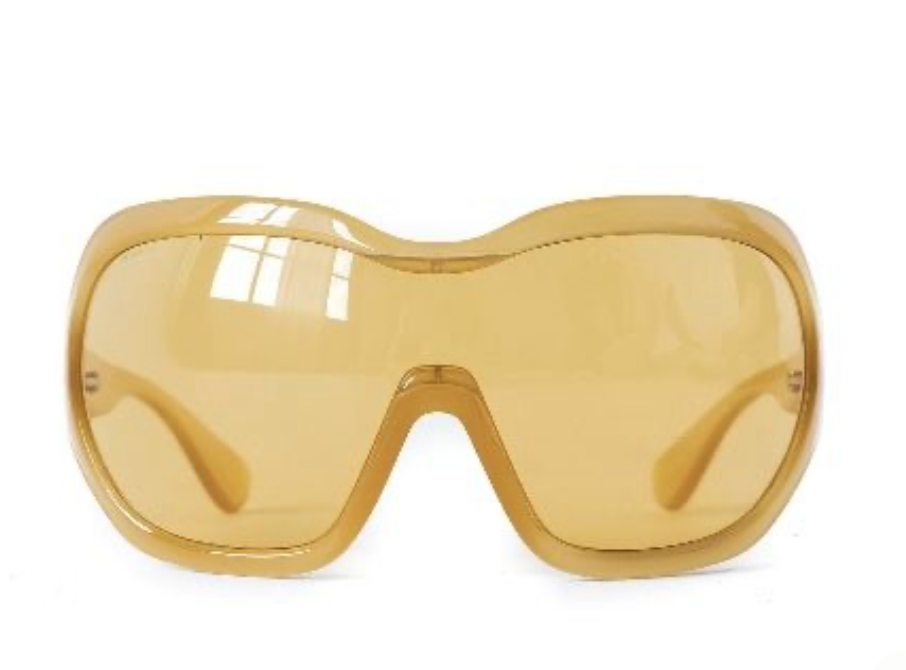
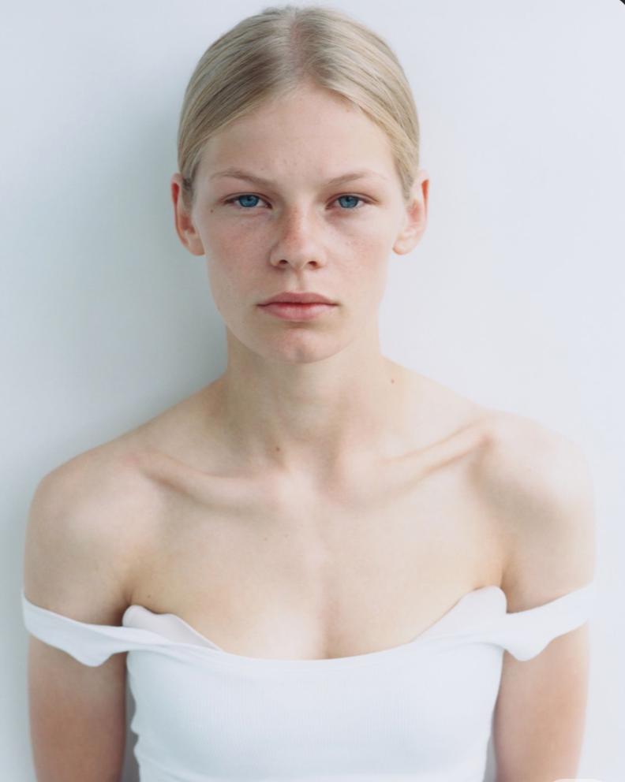
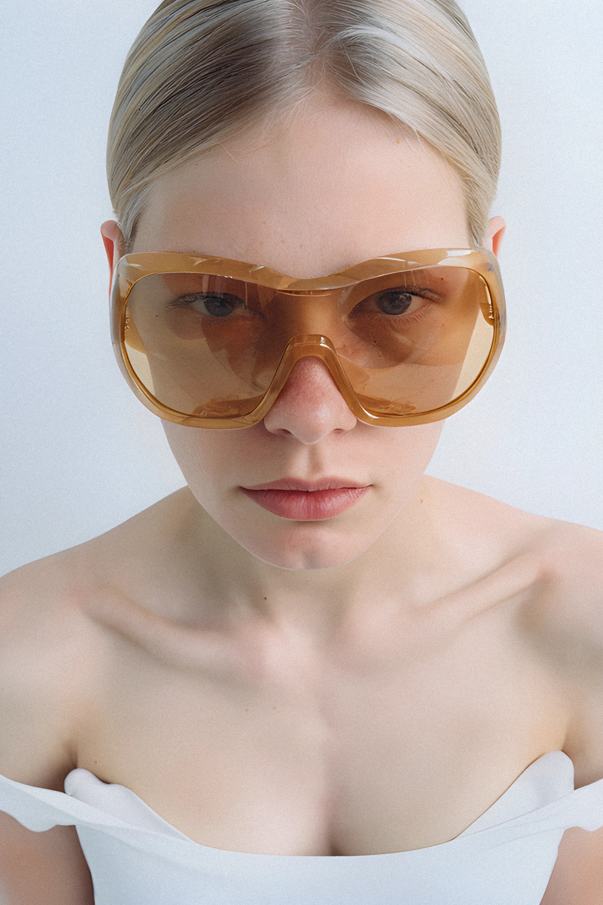
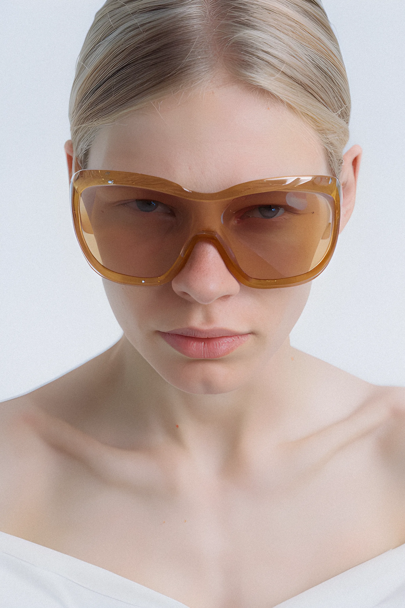
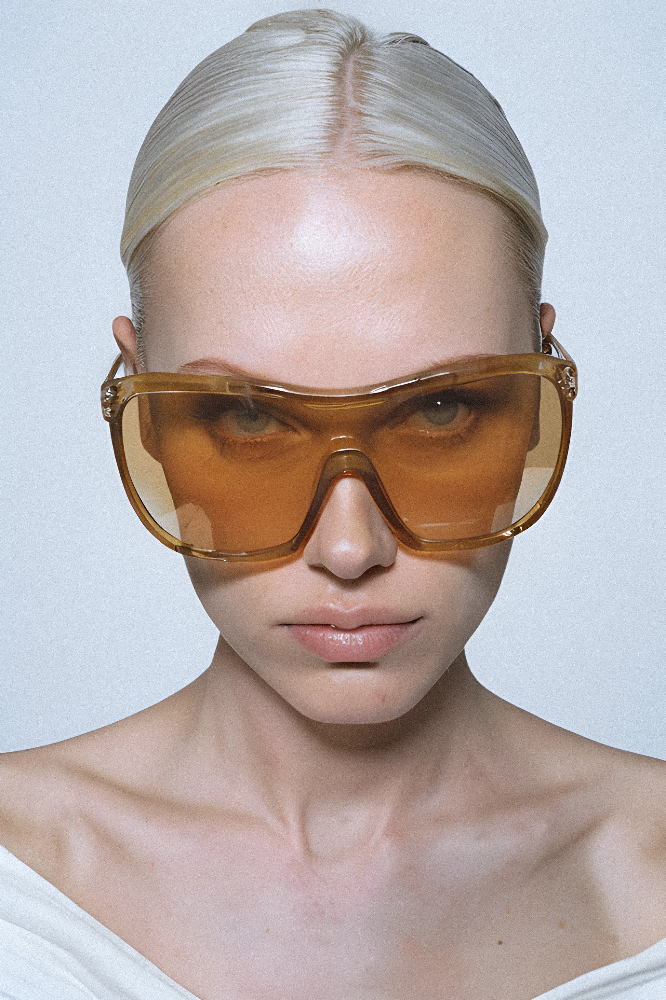
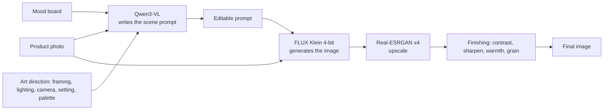
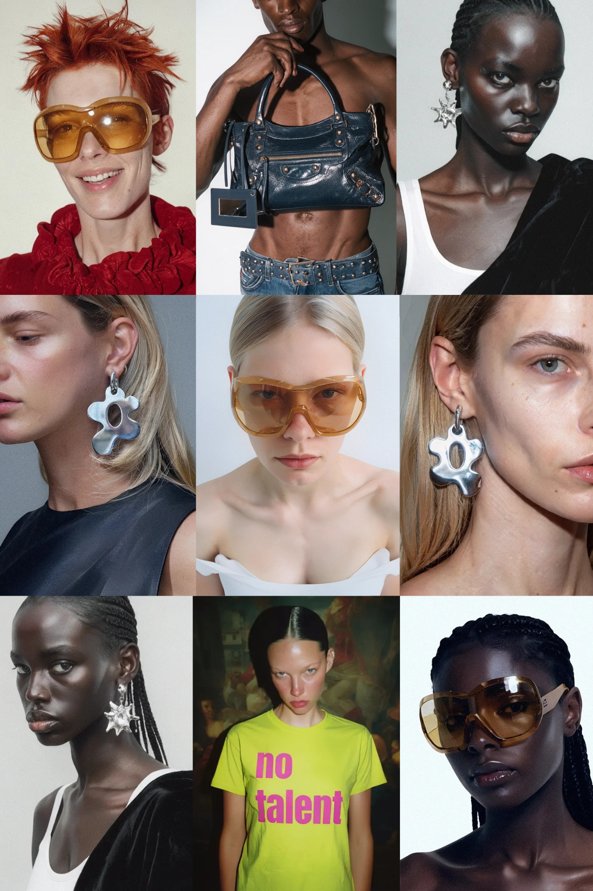

Generate high-resolution, realistic fashion editorial images from a product photo and a optional mood board, using only open-source models and free Kaggle GPUs.

## Idea

Good AI fashion imagery usually costs a monthly subscription (Midjourney and the like). This project tries a different route: a free, open-source generator that anyone can run on their own Kaggle account, without a deep experience in prompting.

Give it a product photo, a mood board, and a short direction. It writes a full scene prompt, generates the image, and upscales it to high resolution. No paid API, just open models and Kaggle's free GPU quota.

It won't beat Midjourney yet, but the goal is to get as close as possible and keep it open for anyone to use.

## Examples

All examples use the same product photo and mood board, generated on a free Kaggle GPU. Images are in `examples/`.

### Prompt

The prompt below was written by Qwen:

```text
Close-up fish-eye portrait, 35mm Canon, studio light background: a model with fair skin and platinum blonde hair pulled back in a sleek chignon, wearing oversized amber-tinted sunglasses with a glossy, translucent plastic frame and curved temple arms, positioned centrally with the face filling the frame from shoulders up, eyes sharply focused and framed by the glasses, soft flash illuminating the subject with gentle highlights on the skin and lenses, the background a seamless, cool-toned white studio wall, the model’s expression neutral and intense, the sunglasses’ reflective surface catching subtle studio light reflections, the fabric of the off-shoulder white top slightly textured and draped over the shoulders, creating a minimalist, high-fashion editorial aesthetic.
```

### Inputs

| Product photo | Mood board |
|---|---|
|  |  |

### Before and after upscaling

| Generated (512 x 768) | Upscaled 2x + finishing |
|---|---|
|  |  |


### Different seeds and the mood board reference

Same prompt and settings, only the seed or the mood board reference changes.

| Seed 1, with mood board reference | Seed 2, with mood board reference | Seed 1, without mood board reference |
|---|---|---|
|  |  |  |

The seed changes the composition and details while the prompt keeps the overall look. Without the mood board reference, the model relies only on the prompt and the product photo.

## How it works



1. **Prompt:** a vision-language model (Qwen3-VL-4B) reads the product photo and mood board and writes a full scene caption. OWn art-direction fields override whatever it picks up from the mood board.
2. **Edit:** the prompt is shown in a text box, so you can also edit it before use.
3. **Generate:** FLUX Klein creates the image from the prompt, with the product photo (and optionally one mood board image) as a reference.
4. **Finish:** Real-ESRGAN upscales the result, then you can also adjust contrast, sharpness, color warmth, and film grain to make it more artistic.

IMPORTANT: Qwen and Klein do not fit on a 16 GB GPU together, so each model loads and unloads on every click.

## Models and tools

| Step | Tool |
|---|---|
| Prompt writing | Qwen3-VL-4B-Instruct |
| Image generation | FLUX 3 Image Klein (community 4-bit build, SDNQ) |
| Upscaling | Real-ESRGAN x4plus (network defined in the repo, official weights downloaded on first use) |
| Interface | Gradio |
| Libraries | PyTorch, Diffusers, Transformers |

## Requirements

- A Kaggle account with a verified phone number (this unlocks GPU resources (30h/week) and internet in notebooks)
- A Hugging Face account and a Read token, saved in Kaggle Secrets as `HF_TOKEN`

## Quick start (Kaggle)

1. Create a new notebook, then set **Accelerator** to a GPU and **Internet** to On.
2. Add your Hugging Face token as a Secret named `HF_TOKEN` and attach it to the notebook.
3. Open `notebooks/run.ipynb` and run them in order.
4. Open the public Gradio link that the last cell prints.

If a step runs out of GPU memory, restart the session before retrying, and lower the aspect ratio or turn off the mood board reference.

## Usage

1. Upload a clear product photo (plain background, whole product visible).
2. Upload a few mood board images.
3. Choose framing and fill in the optional fields (lighting, camera, setting, palette).
4. Click **Generate prompt with Qwen**, then read and edit the prompt.
5. Choose an aspect ratio and seed, then click **Generate image**.
6. Click **Upscale image**, then adjust the finishing sliders. The sliders update the image without re-running the upscaler.

Tips:
- Change the seed for a new variation of the same prompt.
- Generated images are saved to `/kaggle/working/` with the prompt in a matching `.txt` file.
- Full-body shots work best in tall frames (2:3 or 3:4). Square and wide frames suit waist-up and detail shots.

## Repository structure

```
campaign-lens/
├── app.py          # Gradio interface
├── captioner.py    # Qwen prompt writing
├── generator.py    # FLUX Klein generation
├── upscaler.py     # Real-ESRGAN upscaling and finishing
├── utils.py        # shared helpers and constants
├── notebooks/
    ├── fashion-editorial.ipynb
│   └── run.ipynb
├── requirements.txt
├── examples
└── README.md
```



## Limitations

- This is a prototype, tested on Kaggle's free GPUs with a 4-bit model, so output quality and speed are below what a larger GPU and the full-precision model would provide.
- Reference images guide the result but do not lock the product's exact details. Logos, text, stitching, and hardware can drift, and clothing drifts more than rigid items like bags.
- Image editing of a generated result was tried and removed for now: each edit regenerates the whole image and quality drops after a few edits.
- Free GPU sessions are time-limited, and downloaded models are lost when a session ends...


## Licenses

- FLUX Kommunity License v.1.0
